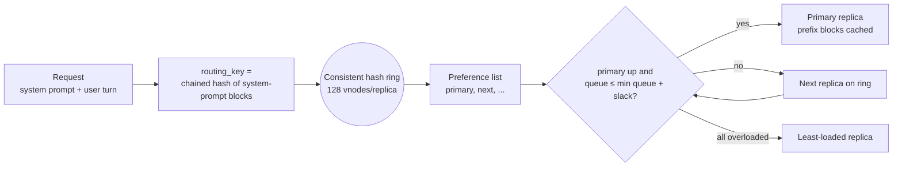

# kv-prefix-router

A load balancer for LLM replicas that hashes the system-prompt prefix onto a consistent-hash ring, so requests sharing a prompt land on the replica that already holds that prefix in its KV cache, with a bounded-load fallback so hot prompts do not melt one replica. A discrete-event simulator of replicas with paged LRU prefix caches compares it to round-robin and least-loaded routing. **All TTFT numbers are SIMULATED.**

## What it is
- `kvrouter/hashring.py` — consistent hash ring (128 virtual nodes per replica) with a preference list per key.
- `kvrouter/prefix.py` — 16-token blocks with chained hashes (a block id names the whole prefix up to it, like paged KV caches); the routing key is the last full block of the system prompt.
- `kvrouter/routers.py` — `PrefixAffinityRouter` (naive or bounded-load), `RoundRobinRouter`, `LeastLoadedRouter`.
- `kvrouter/sim.py` — FIFO replicas; service = prefill of uncached tokens + decode; TTFT = queue wait + prefill; LRU cache of blocks; replica failure (cache wiped, removed from ring).

## Why
Multi-tenant LLM apps resend the same long system prompt on every turn. Engines with prefix caching skip prefill for cached blocks, but only if the request reaches the replica that has them. Round-robin spreads each prompt over every replica, so each replica must cache everything. Pure affinity fixes that but sends a popular tenant's whole load to one box.

## Architecture


## Results
### Routing policies — SIMULATED
Run: `python3 bench/run_sim.py`. Raw output: [`results/simulation.json`](results/simulation.json).

Model (assumptions, not GPU measurements): 8 replicas, one request at a time each, prefill 0.25 ms/token, decode 4 ms/token, 15 ms base, cache 1,500 blocks (24k tokens) per replica. Workload: 6,000 seeded requests, Poisson arrivals at 3 req/s, 40 tenants with Zipf(1.1) popularity, system prompts 800–3,000 tokens, user turns 40–300 tokens.

| Policy (steady state) | Prefix-cache hit rate (tokens) | TTFT p50 | TTFT p95 | TTFT mean | Load max/mean |
|---|---|---|---|---|---|
| round_robin | 60.4% | 77.8 ms | 694.8 ms | 212.0 ms | 1.00 |
| least_loaded | 60.8% | 77.2 ms | 690.0 ms | 208.0 ms | 1.05 |
| prefix_affinity_naive | **88.7%** | 462.0 ms | **16,082 ms** | 4,034 ms | 3.92 |
| prefix_affinity_bounded (slack 0) | 82.0% | **63.0 ms** | **442.8 ms** | **104.2 ms** | 2.00 |

SIMULATED headline, bounded affinity vs least-loaded: **TTFT p50 −18.4%, p95 −35.8%, mean −49.9%**.

With replica r3 failing at 40% of the run, bounded affinity stays ahead (p95 489.8 ms vs 693.2 ms least-loaded); keys on r3 move to the next replica on the ring.

### Sensitivity — SIMULATED
| Setting | least_loaded p95 | naive affinity p95 | bounded affinity p95 |
|---|---|---|---|
| cache 750 blocks (12k tokens) | 723.2 ms | 28,556 ms | 640.6 ms |
| cache 1,500 blocks | 690.0 ms | 16,082 ms | 442.8 ms |
| cache 4,000 blocks (64k tokens) | 478.0 ms | 11,334 ms | 91.8 ms |
| load 2 req/s | 688.2 ms | 2,063.5 ms | 355.0 ms |
| load 4 req/s | 696.8 ms | 395,798 ms | 565.0 ms |
| load 6 req/s | 799.2 ms | 851,707 ms | 690.7 ms |

What it shows:
- **Pure affinity is a trap under skew.** It gets the best hit rate but sends the top tenant's whole load to one replica (3.9× the mean); queueing wait swamps the prefill saving, and at 4–6 req/s that replica's queue grows without bound.
- **Bounded load keeps most of the hit-rate gain** (82% vs 61%) while spilling to the next ring replica as soon as the primary has more work queued than the least-busy replica.
- The advantage shrinks as load rises (p95 gap 333 ms at 2 req/s, 109 ms at 6 req/s): at high utilization, queueing dominates prefill.
- The bound matters: the gain depends on `slack`, and a looser bound drifts toward the naive row.

## Tests
16 tests (`pytest`): ring determinism and balance, minimal remapping on node removal (~1/8 of keys), distinct preference lists, re-add restores mapping, chained block hashes, routing key from system prompt only, replica cache hits / LRU eviction / queue wait in TTFT, same tenant → same replica, fallback when primary down, bounded-load spill, baselines skip down replicas, seeded workload, bounded affinity beats least-loaded on hit rate and mean TTFT in a small run, and the failure scenario serves every request without the dead replica.

```
$ python3 -m pytest -q
................                                                         [100%]
16 passed in 3.26s
```

## Run it
```bash
pip install pytest
python3 -m pytest -q
python3 bench/run_sim.py    # ~1–2 min, writes results/simulation.json
```

## Limits
- **Everything is simulated.** No vLLM / SGLang / TGI replica was run; timing constants are assumptions chosen to be plausible, not measured. Real TTFT gains depend on the engine, GPU and batch behaviour.
- Replicas serve one request at a time. Real engines batch continuously, which changes queueing and makes load less sensitive to a hot tenant.
- The router sees exact queue lengths; a real one sees delayed or estimated load.
- Routing keys on the system prompt only. Multi-turn conversation prefixes (whole chat history) are not keyed.
- The cache model is a token-block LRU; no memory-pressure eviction, no cache sharing between replicas, no cache warm-up after recovery.

## Stack
Python 3.12 · standard library · pytest

## License
MIT
